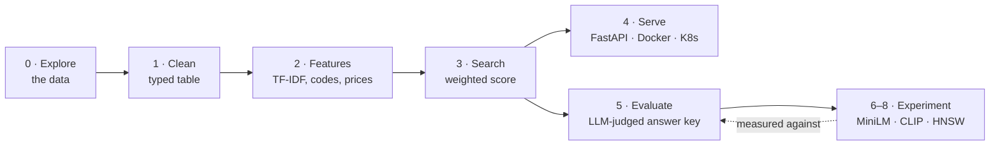
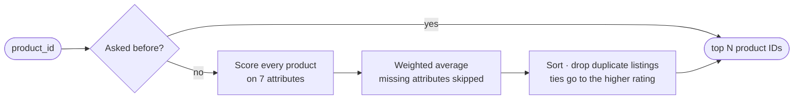

# Product Similarity Search

    

Hi, and thanks for taking the time to read this.

This is my submission for the SAP technical exercise ([Problem_Statement.md](Problem_Statement.md)). The task: given one product's `uniq_id` from **30,000 Amazon fashion products**, return the products most similar to it. Below is how I approached it, what I built, what I tried that didn't pay off, and how I know which is which.

## In short

- **I built** the `find_similar_products` function, a FastAPI service around it, a Docker image, and Kubernetes files to run it on a cluster.
- **My default method** compares 7 attributes, with the title as the strongest signal. It answers in about 22 ms, or about 2 ms for a product asked for before.
- **I tried four alternatives:** title meaning, product photos, both together, and an ANN index. None beat the default on quality. The ANN index matched it, about 3× faster here and about 180× faster at a million products.
- **The data has no labels,** so I built an answer key with an **LLM as a judge** and scored every method against it.

---

## The brief, and what I delivered

| The brief asked for | What I delivered | Where |
|---|---|---|
| **Part 1:** `find_similar_products(product_id, num_similar)` | A weighted similarity over 7 attributes. Missing attributes are skipped, duplicate listings removed, and ties go to the higher rating. | `similarity/search.py` |
| **Part 2:** FastAPI `GET /find_similar_products`  | Checked inputs, 404 / 422 / 500 errors, a health check, and a cache of each product's top 100 | `app.py` |
| Docker image deployable on Kubernetes  | A two-stage, non-root image with a health check | `Dockerfile` |
| Deploy on a local cluster  | A Deployment (2 replicas, probes, rolling updates), a Service and a ConfigMap; run on Docker Desktop | `k8s/` |
| **Part 3:** vector search for large datasets, with the paper and the reasoning | HNSW (Malkov & Yashunin, 2016) via FAISS (Johnson et al., 2017), as an HNSW shortlist followed by an exact re-rank | `similarity/ann.py` |
| Multimodal text + image search  | Title embeddings (MiniLM) and photo embeddings (CLIP). The weights are configurable, and a missing photo falls back to text. | `similarity/embeddings.py`, `similarity/images.py` |
| Suggested: caching | An LRU cache of each product's top 100 | `app.py` |
| Suggested: dimensionality reduction | Considered, but not used. t-SNE is for drawing 2-D pictures, not for search, and at 30,000 products the index works on the full vectors. I'd add PCA at millions. | — |
| Explain design decisions and trade-offs | The sections below, plus one notebook per stage | `notebooks/` |

## How I approached it

I didn't want to start by picking an algorithm. "Similar" only means something once you know what the data can support, so I started with the data and worked in stages. Each stage has a module, a notebook that walks through it, and tests.



My rule throughout was to **measure before believing.** Every idea after stage 5 had to beat the default on the same answer key before it could replace it.

## What the data told me, and how it shaped the cleaning

I profiled all 30,000 products before writing any search code. I set myself one rule for cleaning: **every step had to point to something I found, and nothing missing would be guessed.** A guessed price or brand makes unrelated products look alike, so a missing value stays missing and is skipped when comparing.

| What I found (EDA) | What I decided |
|---|---|
| The same product is sometimes listed twice: 451 products sit on 922 rows, mostly identical copies | Keep every row, so every `uniq_id` still works, but never show the same product twice in results |
| The title is the only descriptive field filled on every row | Make the title the strongest signal: 30% of the score |
| 98% of products share one parent category; the child category is what separates them | Compare child categories, and fall back to `browsenode` where one is missing (5,149 gaps down to 99) |
| Weight is a placeholder (`999999999`) on 79% of rows, and some real values have the wrong unit | Turn the placeholder into "missing", fix the units, drop impossible weights over 20 kg, and give weight only 5% |
| Colour is 80% missing, and is a list (`Black\|White`) | Compare colours as sets (shared ÷ all); 5% |
| Prices are skewed: median ₹590, maximum ₹9,988 | Compare prices as a ratio (smaller ÷ larger), not a difference |
| Half of all single-review products are rated exactly 5.0 | Pull each rating towards the average by its number of reviews (5.0 from 1 review becomes 4.31), and use it only to break ties |
| "generic" and "n/a" appear as brand names | Treat them as no brand |
| Prime, discount, delivery and stock describe the offer, not the product; Prime even flips between two copies of the same listing | Leave them out |

The clean table is checked before it's saved (unique IDs, a title on every row, positive prices, ratings from 1 to 5, weights up to 20 kg) and stored as typed Parquet. That way every later step starts from data I trust. The details are in `notebooks/eda.ipynb` and `notebooks/01_preprocessing.ipynb`.

## How one search works



| Attribute | Title | Category | Price | Brand | Gender | Colour | Weight |
|---|---|---|---|---|---|---|---|
| **Weight** | 30% | 20% | 15% | 15% | 10% | 5% | 5% |
| **Compared by** | TF-IDF cosine | same? | smaller ÷ larger | same? | same? | shared colours | smaller ÷ larger |

## Decisions I'd defend

- **Skip missing attributes; don't score them 0.** Only 3% of products have every attribute, so scoring gaps as 0 would punish almost every pair. Instead, a pair is judged on what both products have, and the other weights are rescaled (Gower's coefficient, 1971). This is also the fallback the brief asks for.
- **Ratios for price and weight.** ₹500 vs ₹1,000 scores the same as ₹5,000 vs ₹10,000, with no units or thresholds to tune.
- **Exact search by default.** At 30,000 products it takes ~22 ms and is always right. I measured that ANN starts to pay off from about 150,000 products, and it's one setting away.
- **CLIP instead of the CNN the brief suggests.** CLIP learned from images with captions, including a lot of fashion. ImageNet, which CNNs like ResNet learn from, has only a handful of clothing classes and none for sarees, kurtas or frocks.
- **Every choice is a setting, not code.** The method, weights, ANN size and paths live in one `.env` file. Switching the API from `tfidf` to `minilm` with ANN search is a two-line change.

## How I evaluated it: an LLM as a judge

The dataset doesn't say which products are similar, so there was no ground truth to test against. Without one, I couldn't tell a *better* method from a merely *different* one. So I built an answer key, using an **LLM as a judge**:

1. **20 test products:** 12 random, and 8 deliberately hard cases (a misspelled title, a brand-only title, missing attributes, a fabric filed under kurtis).
2. **Candidates that don't come from my own method alone.**
   - For each test product, candidates came from four independent routes, plus a sweep of every product of the same kind across the whole catalogue.
   - If the candidates came only from my method, the answer key would just echo its own answers.
3. **The judge.**
   - The LLM rated about 3,900 candidates *good* or *not good* against one written rule: *would a shopper accept this as a similar alternative?* That means the same kind of product, the same audience, a similar style, and a price within about 3×.
   - Results from the photo methods were judged from the photos.
4. **Reference picks:** the judge's 10 best candidates for each test product.
5. **Three questions for every method:**
   - How many reference picks does it find (Recall@10)?
   - How high does the first one land (MRR@10)?
   - How many of its 10 results did the judge rate good (Good@10)?

The ANN search was also checked directly against exact search: 97% recall@10 over 500 random products, plus a scale test with 1,000,000 vectors. Everything lands in `evals/eval_results.xlsx`.

## Experiments and results

| Method | What it tries | Reference picks found | First reference pick (MRR) | Judged good | Time |
|---|---|---:|---:|---:|---:|
| **`tfidf`** (my default) | Title words + 6 attributes | **32%** | **0.82** | **90%** | ~22 ms |
| `minilm` | Title *meaning* (all-MiniLM-L6-v2) | 31% | 0.71 | 88% | ~22 ms |
| `tfidf_image` | + product photo (CLIP ViT-B/32) | 31% | 0.73 | 89% | ~24 ms |
| `minilm_image` | Meaning + photo | 30% | 0.71 | 90% | ~26 ms |
| `tfidf_ann` | `tfidf`, scoring only an HNSW shortlist of 1,000 | **32%** | **0.82** | **90%** | **~8 ms** |

**What I learned**
- **The simple method won.** Title words plus attributes scored best, ahead of both the sentence transformer and the photo model, so they stay the default.
- **Meaning and photos help in specific cases, not on average.** Meaning catches synonyms like *frock* and *dress*, but loses exact words such as brand names. The photo rescues titles that say almost nothing, like *"OOMPH!"*.
- **ANN is about scale, not quality.** It returns the same answers, and at a million products it cuts a search from 1.1 s to about 6 ms.
- **An index can fail quietly.** With default-like HNSW settings, 41 products could never be reached in the graph. I only noticed because two reference picks went missing. More links per product fixed it, and that's why I measure recall instead of trusting the library.

## What I'm not fully happy with

- **20 test products is a small answer key.** Differences of a point or two between methods are within noise.
- **The judge is an LLM, not a shopper,** and it mostly read titles, which probably under-credits the photo methods. Next, I'd have a person spot-check a sample of its judgements, and build a photo-based key.
- **The weights are set by judgement** from the data, not learned.

## With more time, I would

- **Precompute every product's top 100 offline** and serve it with a key lookup. The API's input is always an existing product, so every answer can be computed ahead of time.
- **Compress the vectors** (PCA + product quantization) and move the index to a vector database, to reach millions of products.
- **Learn the weights** from clicks and purchases.

## Run it on your machine

```bash
git clone <repo-url> && cd <repo-folder>   # the folder git creates; use your own name if you renamed it
python -m venv venv
source venv/bin/activate            # Windows: venv\Scripts\activate
pip install -r requirements.txt

python -m similarity.preprocessing  # raw data -> data/processed/products.parquet (~3 s)
uvicorn app:app --port 8000         # then open http://localhost:8000/docs
```

```bash
curl "http://localhost:8000/find_similar_products?product_id=26d41bdc1495de290bc8e6062d927729&num_similar=5"
```

**Docker**
```bash
docker build -t product-similarity .
docker run --rm -p 8000:8000 product-similarity
```

**Kubernetes** (for example on Docker Desktop)
```bash
docker tag product-similarity product-similarity:1.0
kubectl apply -f k8s/               # then open http://localhost:30080/docs
```

**Tests, notebooks and experiments**
```bash
pip install -r requirements-dev.txt
pytest                              # 122 tests
python -m similarity.embeddings     # MiniLM title vectors (~4 min)
python -m similarity.images download && python -m similarity.images embed   # photos + CLIP (~40 min)
python -m similarity.ann build      # HNSW index (~1 min)
python -m evals.run_eval            # score every method
```

**Switch the method:** copy `.env.example` to `.env`, set for example `SIMILARITY_METHOD=minilm` and `SEARCH_MODE=ann`, then restart. Every setting is in [`.env.example`](.env.example), with its default and what it does.

## Project map

```
similarity/          the search: preprocessing → features → search, plus embeddings, images, ann, config
app.py               the FastAPI service
evals/               the LLM-judged evaluation and the ANN benchmark
notebooks/           one walkthrough notebook per stage
k8s/                 Deployment, Service, ConfigMap
tests/               122 tests
.env.example         every setting, with its default
```
